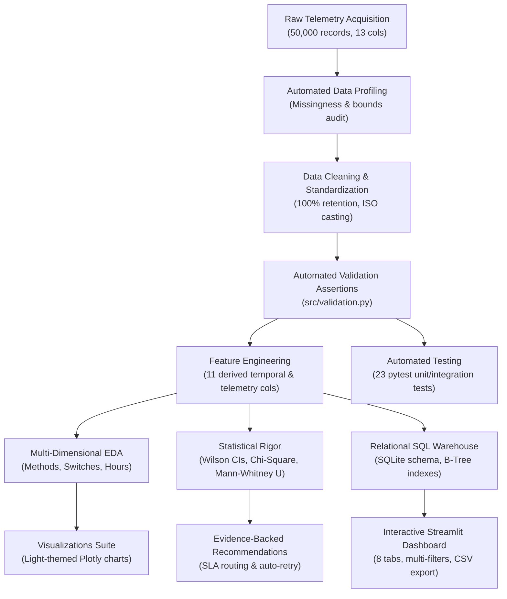
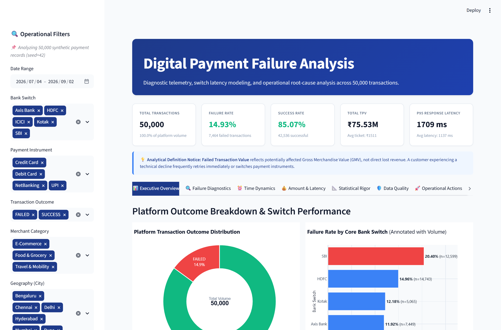
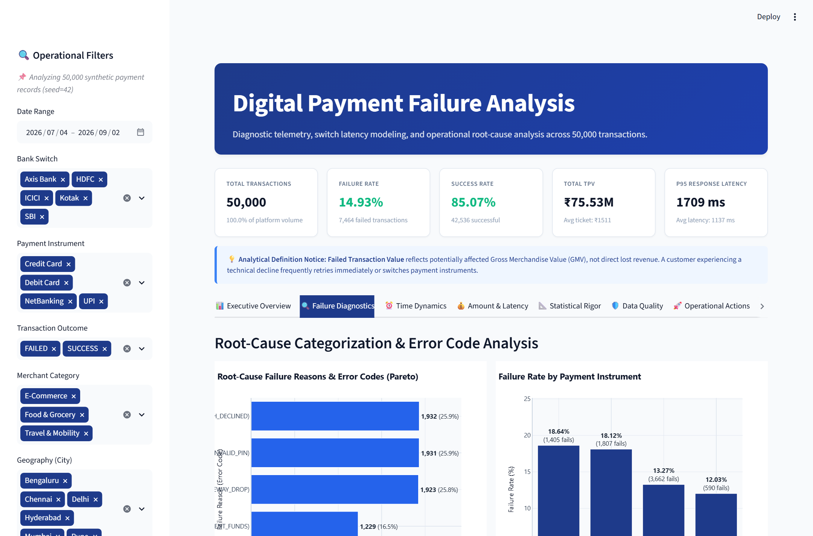
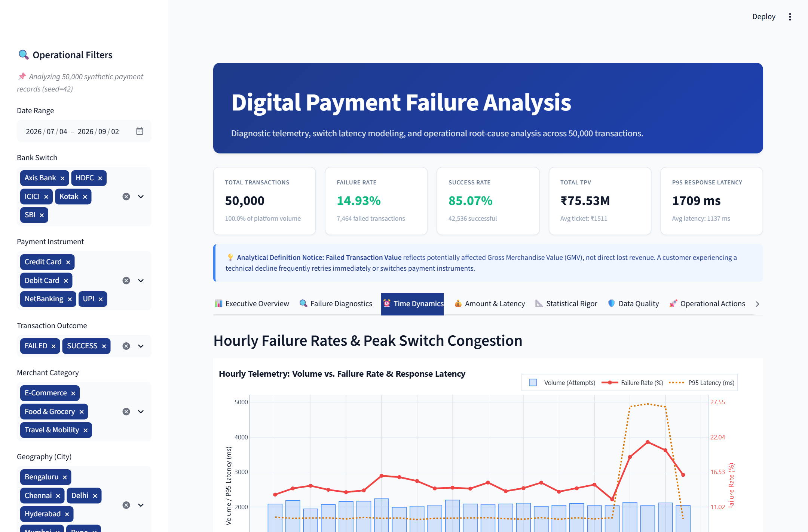
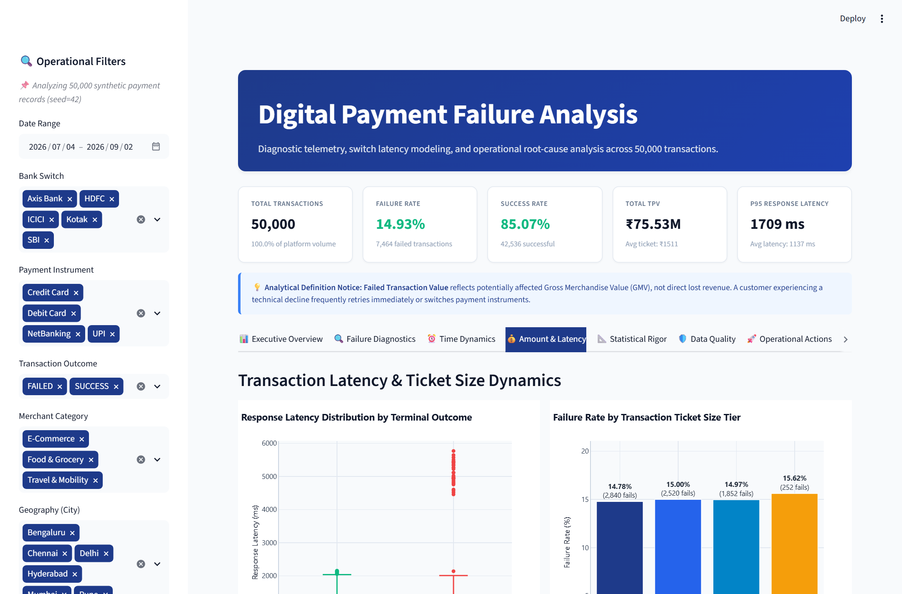
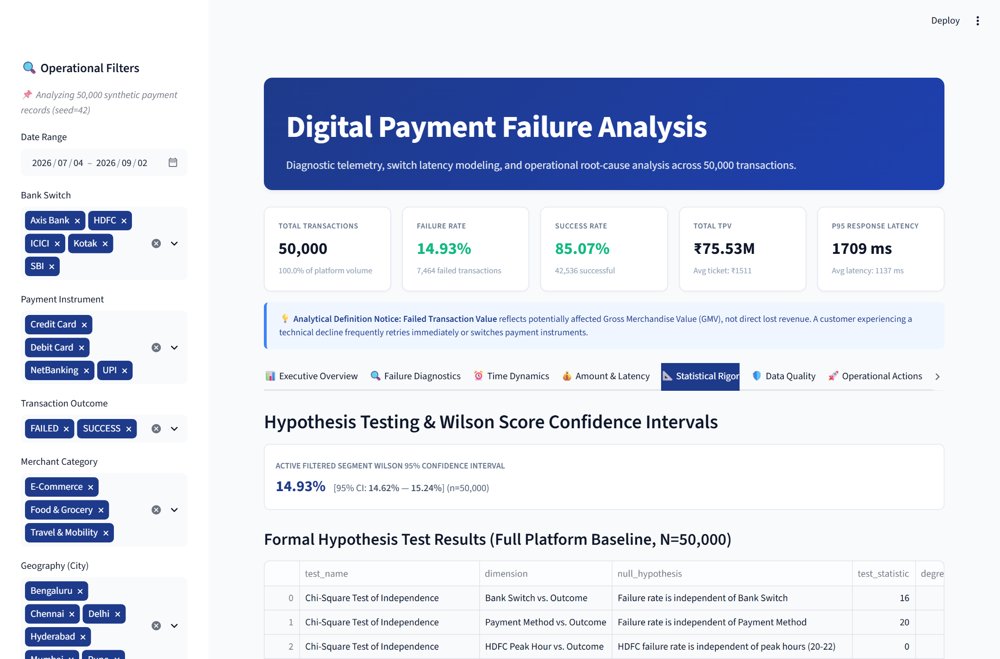
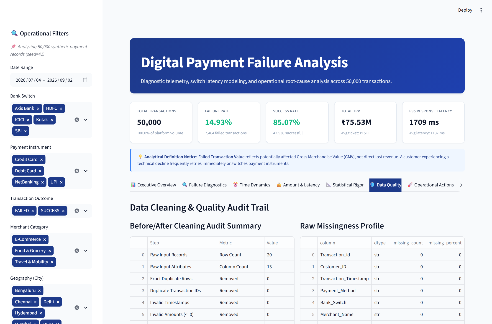
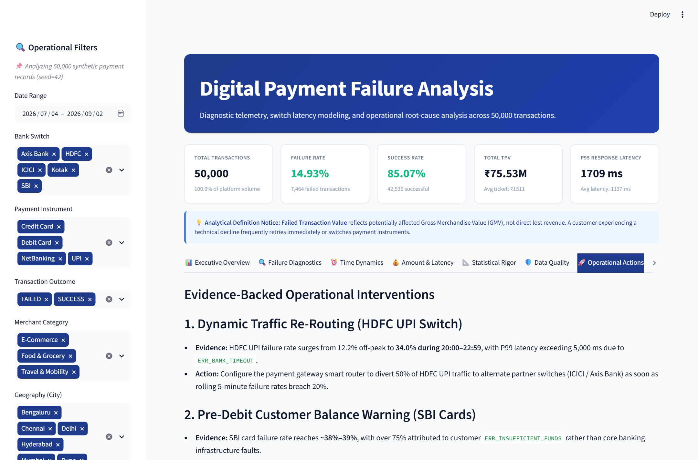
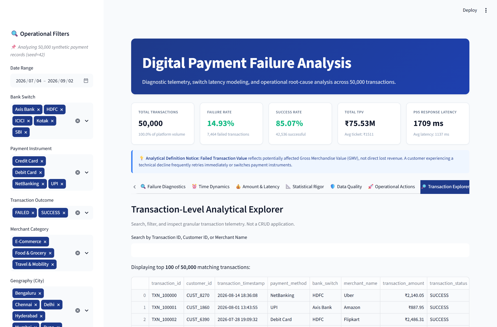

# Digital Payment Failure Analysis

[](https://www.python.org/)
[](https://www.sqlite.org/)
[](https://streamlit.io/)
[](https://docs.pytest.org/)
[](LICENSE)
[-amber.svg)](docs/DATASET_CARD.md)

An end-to-end fintech data analytics platform diagnosing root causes, switch latency spikes, and failure vulnerabilities across **50,000 payment transactions** representing **₹75.53M in Total Payment Volume (TPV)**.

---

## 📌 Executive Summary & Key Results

* **Total Transaction Volume:** 50,000 attempts across UPI, Credit Card, Debit Card, and NetBanking.
* **Platform Outcome Distribution:** **85.07% Success** (42,536 txns) | **14.93% Failure** (7,464 txns).
* **Total Payment Volume (TPV):** **₹75,531,423.82** (~₹75.53M).
* **Potentially Affected GMV (Failed TPV):** **₹11,318,271.81** (~₹11.32M) — *safely distinguished from permanent lost revenue*.
* **Average Round-Trip Latency:** **1,137.13 ms** (P50: 1,104.0 ms | P95: 1,709.0 ms | P99: 2,155.04 ms).
* **Peak-Hour Switch Bottleneck:** During 20:00–22:59, HDFC switch failure rates surge from **12.23%** off-peak to **34.04%** peak ($\chi^2 = 603.44, p = 2.99 \times 10^{-133}$), driven by switch timeouts (`ERR_BANK_TIMEOUT`) with a $+960\text{ ms}$ latency penalty.
* **Customer Balance Declines on SBI:** SBI logs the highest overall failure rate (**20.40%**), but **75.3%** of its declines stem from customer-side low balance (`ERR_INSUFFICIENT_FUNDS`), not switch infrastructure downtime.
* **Automated Quality & Integrity:** 23 automated `pytest` unit/integration tests running in **<3s**, with **100.0% metric agreement** between Python calculations and SQLite queries.

---

## 🏗️ End-to-End Workflow Architecture



---

## 🖥️ Interactive Dashboard Walkthrough (All 8 Tabs)

The platform provides a light-themed analytics dashboard built in Streamlit and Plotly, supporting multi-dimensional operational filtering across date ranges, core bank switches, payment rails, outcome statuses, merchant sectors, geography, and ticket amounts.

### Platform Overview & KPI Banner


<details open>
<summary><b>Click to expand screenshots and analytical view of all 8 tabs</b></summary>
<br/>

| Tab Navigation | High-Resolution Interface Preview | Core Analytical Function |
| :--- | :--- | :--- |
| **Tab 1: Executive Overview** |  | Donut outcome breakdown (**85.07% Success** vs **14.93% Failure**), bank switch failure rankings, and financial KPI summary table. |
| **Tab 2: Failure Diagnostics** |  | Error code Pareto distribution, payment method divergence, and Bank Switch $\times$ Rail cross-tabulation failure matrix. |
| **Tab 3: Time Dynamics** |  | Dual-axis hourly volume vs failure rate & P95 latency; audit of HDFC's peak-hour (20:00–22:59) switch timeout surge. |
| **Tab 4: Amount & Latency** |  | Latency box plots comparing `SUCCESS` against `FAILED`, alongside ticket size tier analysis (~14.7%–15.1% invariance). |
| **Tab 5: Statistical Rigor** |  | Real-time dynamic Wilson 95% Confidence Interval for active filters + Chi-Square ($\chi^2$), Cramer's V, and Mann-Whitney U test summaries. |
| **Tab 6: Data Quality** |  | Before/after data cleaning audit (100% retention across 50,000 records), raw missingness profile, and validation assertion badges. |
| **Tab 7: Operational Actions** |  | Evidence-backed operational interventions (HDFC dynamic routing, SBI balance prompts, 1-click retry) + synthetic provenance notice. |
| **Tab 8: Transaction Explorer** |  | Granular transaction search (by TXN ID, Customer ID, or Merchant), formatted telemetry table, and CSV data export (up to 1,000 records). |

</details>

---

## 🛠️ Technology Stack & Purpose

| Layer | Technology | Primary Function in Project |
| :--- | :--- | :--- |
| **Language** | Python 3.13.2 | Core data processing, orchestration, and statistical calculation engine. |
| **Data Processing** | Pandas 3.1 & NumPy 2.5 | Vectorized data cleaning, grouping, time bucketing, and metric aggregation. |
| **Relational Database** | SQLite 3 | Embedded relational analytics warehouse executing CTEs and window queries. |
| **Statistical Methods** | SciPy 1.18 | Wilson Score confidence intervals, Chi-square test ($\chi^2$), Cramer's V, Mann-Whitney U. |
| **Visualization** | Plotly 7.1 | Publication-grade interactive charts (dual-axis, heatmaps, pareto, box plots). |
| **Interactive Dashboard**| Streamlit 1.66 | Modern light-themed executive and operations portal with real-time filtering. |
| **Quality Assurance** | Pytest 9.2 & Pytest-Cov | 23 automated unit tests validating cleaning rules, denominators, and SQL consistency. |
| **Notebooks** | Jupyter & nbformat | Structured educational and investigative workflow notebooks. |

---

## 📁 Repository Directory Structure

```
Digital-Payment-Failure-Analyzer/
├── app.py                                  # Streamlit Interactive Dashboard
├── requirements.txt                        # Pinned dependencies for Python 3.13
├── .gitignore                              # Git exclusion rules
├── README.md                               # Project documentation
├── data/
│   ├── raw/                                # Raw immutable telemetry CSV
│   ├── processed/                          # Cleaned analytical dataset
│   ├── sample/                             # Test fixture sample (500 rows)
│   └── payment_analytics.db                # Indexed SQLite analytical warehouse
├── docs/
│   ├── PROJECT_OVERVIEW.md                 # Business context & research questions
│   ├── DATASET_CARD.md                     # Provenance, schema & limitations
│   ├── DATA_DICTIONARY.md                  # Column definitions and constraints
│   ├── CLEANING_LOG.md                     # Data transformation audit trail
│   ├── METHODOLOGY.md                      # Mathematical formulations & test logic
│   ├── FINDINGS.md                         # Detailed evidence & interpretations
│   ├── LIMITATIONS.md                      # Synthetic constraints & ethical boundaries
│   └── REPRODUCIBILITY.md                  # Step-by-step setup guide
├── notebooks/
│   ├── 01_data_understanding.ipynb         # Raw data ingestion & profiling
│   ├── 02_data_cleaning.ipynb              # Standardization & validation
│   ├── 03_exploratory_analysis.ipynb       # Diagnostic slicing & EDA
│   └── 04_statistical_analysis.ipynb       # Hypothesis testing & effect sizes
├── reports/
│   ├── figures/                            # Exported standalone interactive HTML charts
│   └── tables/                             # 19 analytical summary CSV tables
├── sql/
│   ├── schema.sql                          # Relational table definition with indexes
│   └── analysis_queries.sql                # 8 advanced analytical queries (CTEs, Window)
├── src/
│   ├── __init__.py                         # Package identifier
│   ├── config.py                           # Paths, categories, and color palette
│   ├── data_loader.py                      # Acquisition & reproducible generator
│   ├── profiling.py                        # Automated data quality profiler
│   ├── cleaning.py                         # Production cleaning pipeline
│   ├── validation.py                       # Business rules & assertion engine
│   ├── feature_engineering.py              # Temporal & latency band derivation
│   ├── metrics.py                          # Robust KPI calculation engine
│   ├── analysis.py                         # Multi-dimensional aggregations
│   ├── statistics_analysis.py              # Chi-Square, Wilson CIs, Mann-Whitney U
│   ├── database.py                         # SQLite ingest & query executor
│   ├── charts.py                           # Plotly visualization suite
│   ├── reporting.py                        # End-to-end pipeline orchestrator
│   └── create_notebooks.py                 # Notebook generation script
└── tests/
    ├── __init__.py
    ├── conftest.py                         # Small synthetic fixtures
    ├── test_cleaning.py                    # Tests for schema & normalization
    ├── test_metrics.py                     # Tests for denominator safety & KPIs
    ├── test_statistics.py                  # Tests for statistical functions
    ├── test_database.py                    # Tests for SQLite schema & queries
    └── test_pipeline.py                    # Full integration tests
```

---

## 📊 Dataset Provenance & Disclosure

> [!IMPORTANT]
> **Synthetic Telemetry Disclosure:** This dataset was created algorithmically with Python (`np.random.seed(42)`) by [Manoj Mali](https://github.com/ManojMaliDev/Digital-Payment-Transaction-Health-Analytics). 
> 
> Under no circumstances should observed bank switch performance or latency metrics be interpreted as actual historical data of real commercial banks (HDFC, SBI, ICICI, Axis Bank, Kotak) or the National Payments Corporation of India (NPCI).

### Dataset Schema Summary (13 Raw $\rightarrow$ 24 Analytical Columns)
* **`transaction_id`**: Primary key (`TXN_100000` to `TXN_149999`, 50,000 unique records).
* **`customer_id`**: Client identifier (`CUST_1000` to `CUST_9999`).
* **`transaction_timestamp`**: Timestamp spanning a 60-day window (`2026-07-04` to `2026-09-02`).
* **`payment_method`**: `UPI` (55.2%), `Credit Card` (19.9%), `Debit Card` (15.1%), `NetBanking` (9.8%).
* **`bank_switch`**: `HDFC` (29.5%), `SBI` (25.2%), `ICICI` (20.3%), `Axis Bank` (14.9%), `Kotak` (10.1%).
* **`merchant_name` & `merchant_category`**: `Amazon`, `Flipkart`, `Swiggy`, `Uber`, etc. across `E-Commerce`, `Food & Grocery`, `Travel & Mobility`.
* **`geography`**: Metropolitan regions (`Mumbai`, `Bengaluru`, `Delhi`, `Pune`, `Chennai`, `Hyderabad`).
* **`transaction_amount`**: Ticket size in INR (₹100 to ₹15,196.92, mean: ₹1,510.63, median: ₹1,071.82).
* **`transaction_status`**: Final outcome (`SUCCESS`: 42,536 | `FAILED`: 7,464).
* **`error_code`**: `SUCCESS_00`, `ERR_BANK_TIMEOUT`, `ERR_INSUFFICIENT_FUNDS`, `ERR_AUTH_DECLINED`, `ERR_INVALID_PIN`, `ERR_GATEWAY_DROP`.
* **`failure_reason`**: `None` (for success), `Bank Switch Unresponsive`, `Customer Account Low Balance`, `Authentication / Network Failure`.
* **`latency_ms`**: Round-trip response time (250 ms to 6,173 ms).

---

## 📈 Key Findings & Root-Cause Diagnoses

### 1. HDFC Switch Collapse During Evening Peak Window (20:00 – 22:59)
* **The Problem:** Across all 24 hours, HDFC appears normal (14.96% failure rate vs. 14.93% platform average). However, during peak evening hours (20:00 to 22:59), HDFC failure rates surge to **34.04%** (compared to **12.23%** off-peak).
* **Latency Telemetry:** HDFC peak average latency jumps by **$+960.38\text{ ms}$**, with P99 latency reaching **5,307 ms**.
* **Error Signature:** Exactly **449 transactions** fail with `ERR_BANK_TIMEOUT` (`Bank Switch Unresponsive`), and **100% of these timeouts** are concentrated during the 20:00–22:59 window on HDFC.
* **Control Evidence:** During the exact same hours, ICICI (11.65%), Axis Bank (11.40%), and Kotak (11.62%) maintain stable performance with zero latency spikes, confirming a switch-specific bottleneck.

### 2. SBI Elevated Failure Rate: Business Decline, Not Switch Fault
* **The Problem:** SBI exhibits the highest overall failure rate on the platform (**20.40%**), logging 2,570 failed transactions.
* **Root-Cause Isolation:** SBI average latency is **1,096.30 ms** (completely normal). Declines are driven by `ERR_INSUFFICIENT_FUNDS` on SBI Card rails (1,229 transactions; 47.8% of SBI failures).
* **Operational Implication:** Engineering teams should not waste resources debugging SBI switch latency; user-side balance friction is the sole driver.

### 3. Transient Drops Account for 77.5% of All Dropoffs
* Over three-quarters of all failures (5,786 of 7,464) stem from `ERR_AUTH_DECLINED` (25.88%), `ERR_INVALID_PIN` (25.87%), and `ERR_GATEWAY_DROP` (25.76%).
* Average latency for these errors is normal (~1,090 ms), indicating immediate dropped connections or credential mistypes that have a high probability of recovery.

### 4. Instrument Reliability Comparison
* **Debit Card (18.64%)** and **Credit Card (18.12%)** exhibit significantly higher failure rates than **UPI (13.27%)** and **NetBanking (12.03%)** ($\chi^2 = 253.95, p < 10^{-50}$).
* Multi-hop card authentication redirects (merchant $\rightarrow$ gateway $\rightarrow$ network $\rightarrow$ issuing bank ACS $\rightarrow$ OTP) compound dropoff risks compared to UPI's native mobile authorization flow.

---

## 🚀 Evidence-Backed Operational Interventions

1. **Dynamic Traffic Re-Routing (HDFC UPI Switch):**
   * *Trigger:* When rolling 5-minute HDFC failure rate exceeds **20%** between 20:00 and 23:00.
   * *Action:* Payment gateway smart router automatically diverts **50% of UPI traffic** to resilient backup processors (ICICI / Axis Bank).
2. **Pre-Debit Balance Prompt (SBI Cards):**
   * *Action:* Detect high-ticket card intents for SBI accounts and prompt the user with an in-app balance reminder or suggest using an alternate verified UPI handle.
3. **1-Click Silent Auto-Retry for Gateway Drops:**
   * *Action:* For `ERR_GATEWAY_DROP`, initiate a silent auto-retry within a **3-second window** before showing an explicit failure screen to the consumer.

---

## 📐 Statistical Rigor & Hypothesis Testing

All hypothesis tests were evaluated at $\alpha = 0.05$ with sample sizes $N = 50,000$:

| Test | Dimension Tested | Test Statistic | p-value | Effect Size | Operational Conclusion |
| :--- | :--- | :--- | :--- | :--- | :--- |
| **Chi-Square ($\chi^2$)** | Bank Switch vs. Outcome | $\chi^2 = 465.22$ | $2.23 \times 10^{-99}$ | Cramer's $V = 0.096$ | Significant; SBI and HDFC carry elevated failure risks. |
| **Chi-Square ($\chi^2$)** | Payment Method vs. Outcome | $\chi^2 = 253.95$ | $9.14 \times 10^{-55}$ | Cramer's $V = 0.071$ | Significant; Cards have significantly higher decline rates than UPI/NetBanking. |
| **Chi-Square ($\chi^2$)** | HDFC Peak Hours vs. Outcome | $\chi^2 = 603.44$ | $2.99 \times 10^{-133}$ | Cramer's $V = 0.202$ | Strong effect; Evening congestion triples HDFC failure probability. |
| **Mann-Whitney U** | Latency: Failed vs. Success | $U = 1.658 \times 10^8$| $8.16 \times 10^{-10}$ | Rank-biserial $r = -0.045$| Significant latency elevation in failed transactions due to timeout spikes. |
| **Pairwise Chi-Square** | SBI vs. Platform Remainder | $\chi^2 = 396.32$ | $3.48 \times 10^{-88}$ | Odds Ratio = 1.70 | Statistically elevated failure rate on SBI ($p < \alpha_{\text{Bonferroni}} = 0.010$). |
| **Pairwise Chi-Square** | ICICI vs. Platform Remainder | $\chi^2 = 106.56$ | $5.55 \times 10^{-25}$ | Odds Ratio = 0.71 | Statistically superior reliability on ICICI ($p < 0.010$). |

---

## 💻 Quick Start & Reproducibility

### 1. Installation
```powershell
# Clone the repository
git clone https://github.com/NagaDeepika-git/Digital_Payment_Failure_Analysis.git
cd Digital_Payment_Failure_Analysis

# Create and activate virtual environment
python -m venv .venv
.\.venv\Scripts\Activate.ps1

# Install pinned dependencies
python -m pip install --upgrade pip
pip install -r requirements.txt
```

### 2. Run the Complete End-to-End Analytics Pipeline
```powershell
python -m src.reporting
```
*Executes data loading, profiling, cleaning, validation, feature engineering, exploratory analysis, hypothesis testing, SQLite loading, query verification, and chart export in ~4 seconds.*

### 3. Launch the Interactive Streamlit Dashboard
```powershell
streamlit run app.py
```
*Access the dashboard at `http://localhost:8501`.*

### 4. Run Automated Test Suite
```powershell
pytest -v
```
*Output: **23 passed in ~2.8s**.*

---

## 🧪 Automated Testing & Metric Verification

The project includes 23 comprehensive automated tests covering:
- Schema validation, required columns, and data type assertions (`test_cleaning.py`).
- Numeric range bounds (rejecting negative amounts or negative latencies).
- Status consistency assertions (`SUCCESS` requires `SUCCESS_00` and `None` failure reason).
- Zero-denominator protection on empty data slices (`test_metrics.py`).
- Weighted group failure rate calculations ($N_{\text{failed}} / N_{\text{total}}$).
- Wilson Score confidence interval mathematical bounds (`test_statistics.py`).
- Cramer's V effect size properties.
- Visualization suite, light theme styling, and chart generators (`test_charts.py`).
- SQLite schema generation, index validation, and execution of 8 named SQL queries (`test_database.py`).
- **Python-SQL Metric Audit:** Asserted zero divergence across total transactions, failed counts, failure rate, and TPV.

---

## ⚖️ Limitations & Ethical Considerations

1. **Synthetic Telemetry:** Analysis demonstrates authentic data engineering and analytical methodologies, but results must not be represented as actual commercial bank performance.
2. **Failed Value vs. Permanent Loss:** Failed transaction amounts represent **potentially affected Gross Merchandise Value (GMV)**, not permanent lost revenue, as customers frequently retry or switch methods.
3. **Observational Bounds:** Correlation does not establish mechanical causality without low-level server telemetry logs (thread dumps, network packet traces).

---

## 👤 Author & Attribution

* **Author:** Naga Deepika ([@NagaDeepika-git](https://github.com/NagaDeepika-git))
* **Repository:** [Digital_Payment_Failure_Analysis](https://github.com/NagaDeepika-git/Digital_Payment_Failure_Analysis.git)
* **Dataset Credit:** Generated and published by Manoj Mali ([ManojMaliDev/Digital-Payment-Transaction-Health-Analytics](https://github.com/ManojMaliDev/Digital-Payment-Transaction-Health-Analytics)).
