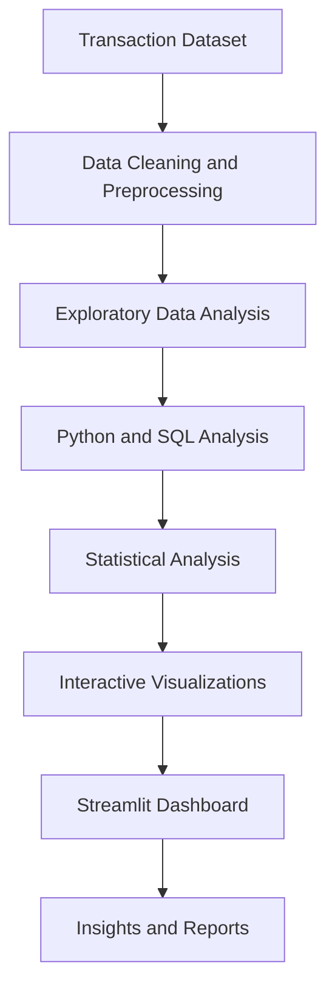

# Digital Payment Failure Analysis

An end-to-end data analytics project that explores digital payment transaction performance, identifies failure patterns, and presents actionable insights through an interactive Streamlit dashboard.

The project analyzes **50,000 synthetic digital payment transactions** using Python, SQL, and data visualization techniques.

## Project Overview

Digital payment failures can occur for several reasons, including insufficient balance, transaction timeouts, bank-side issues, and payment processing errors.

This project examines transaction data to understand:

- Overall payment success and failure rates
- Failure patterns across banks and payment methods
- Transaction trends across different time periods
- Transaction latency and processing performance
- Common failure reasons and their distribution

The analysis is presented through an interactive dashboard designed to make the results easier to explore.

## Key Results

| Metric | Result |
|---|---:|
| Total Transactions | 50,000 |
| Successful Transactions | 42,536 |
| Failed Transactions | 7,464 |
| Success Rate | 85.07% |
| Failure Rate | 14.93% |
| Total Transaction Value | ₹75.53 Million |
| Average Transaction Value | ₹1,510.63 |
| Average Latency | 1,137.13 ms |

*These figures are calculated from the synthetic dataset used in this project.*

## Dashboard Preview


The Streamlit dashboard contains eight sections:

1. **Executive Overview** – Key transaction metrics and overall performance.
2. **Bank Analysis** – Comparison of transaction performance across banks.
3. **Payment Method Analysis** – Success and failure patterns across payment methods.
4. **Failure Analysis** – Distribution of transaction failure reasons.
5. **Time Analysis** – Transaction patterns across different hours and time periods.
6. **Latency Analysis** – Transaction processing time and latency distribution.
7. **Statistical Analysis** – Statistical tests used to examine selected patterns.
8. **SQL Analysis** – Transaction analysis using SQL queries.

<details>
<summary>View more dashboard screenshots</summary>

### Bank Analysis


### Payment Method Analysis


### Failure Analysis


### Time Analysis


### Latency Analysis


### Statistical Analysis


### SQL Analysis


</details>

## Tools and Technologies

| Category | Technologies |
|---|---|
| Programming | Python |
| Data Processing | Pandas, NumPy |
| Statistical Analysis | SciPy |
| Data Visualization | Matplotlib, Seaborn, Plotly |
| Dashboard | Streamlit |
| Database | SQLite |
| Query Language | SQL |
| Testing | Pytest |
| Development | Jupyter Notebook, VS Code |

## Analysis Highlights

The analysis explores several patterns in the dataset:

- **Bank performance:** Compares transaction success and failure rates across banks.
- **Time-based patterns:** Examines how transaction outcomes vary during different hours.
- **Payment methods:** Identifies differences in transaction performance across payment methods.
- **Failure reasons:** Studies the distribution of common transaction failure categories.
- **Latency:** Examines processing times, including percentile-based latency measurements.
- **Statistical analysis:** Uses statistical techniques to investigate selected relationships in the data.

For example, the synthetic dataset shows a higher failure rate for HDFC transactions during the 20:00–22:59 period than during off-peak hours. This is an observed pattern in the dataset, not evidence of actual bank performance.

## Project Workflow



## Repository Structure

```text
Digital-Payment-Failure-Analyzer/
│
├── .streamlit/          # Streamlit configuration
├── assets/
│   └── screenshots/    # Dashboard screenshots
│
├── data/
│   ├── processed/      # Cleaned transaction data
│   └── sample/         # Sample transaction data
│
├── docs/               # Project documentation
├── notebooks/          # Data analysis notebooks
├── reports/
│   └── tables/         # Generated analysis tables
│
├── sql/                # SQL queries
├── src/                # Data processing and analysis modules
├── tests/              # Automated tests
│
├── app.py              # Streamlit dashboard
├── requirements.txt    # Python dependencies
├── LICENSE
└── README.md
```

## Installation and Setup

### Prerequisites

- Python 3.10 or later
- Git

### 1. Clone the repository

```bash
git clone https://github.com/NagaDeepika-git/Digital_Payment_Failure_Analysis.git
cd Digital_Payment_Failure_Analysis
```

### 2. Create a virtual environment

```bash
python -m venv .venv
```

Activate it on Windows:

```bash
.venv\Scripts\activate
```

### 3. Install dependencies

```bash
pip install -r requirements.txt
```

### 4. Prepare the data

The original raw dataset and generated SQLite database are not included in this repository. Follow the instructions in `docs/REPRODUCIBILITY.md` to obtain and prepare the required data before running the complete analysis workflow.

### 5. Run the dashboard

```bash
streamlit run app.py
```

The dashboard will open in your browser, usually at:

`http://localhost:8501`

## Running Tests

Run the automated test suite using:

```bash
pytest -v
```

The project test suite contains 23 tests covering key analysis and application functionality.

## Dataset and Limitations

- The project uses a synthetic dataset containing 50,000 digital payment transactions.
- The dataset is attributed to its original source: [Digital Payment Transaction Health Analytics](https://github.com/ManojMaliDev/Digital-Payment-Transaction-Health-Analytics).
- The dataset is used for educational and analytical purposes.
- The results should not be interpreted as actual performance statistics for banks, payment providers, or financial institutions.
- Observed relationships do not necessarily establish causation.
- Failed transaction value represents the value associated with failed transactions, not confirmed financial loss.

## Future Improvements

- Integrate real-time or regularly updated transaction data.
- Extend failure prediction using machine learning.
- Add more interactive filters and detailed reports.
- Improve monitoring of transaction performance and latency.

## Author

**Gogineni Naga Deepika**
